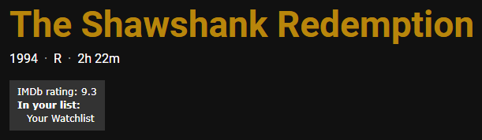
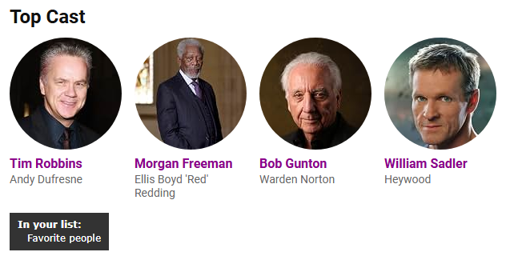
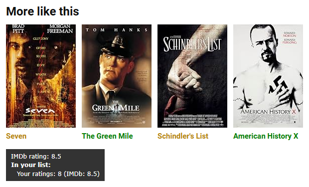
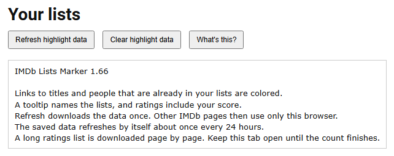

# IMDb Lists Marker

Userscript that colors IMDb links for titles and people already in your lists. Version `1.66`. License `GPL-3.0-or-later`.

The file is `imdb-lists-marker.user.js`.

Based on IMDb 'My Movies' enhancer by Ricardo Mendonça Ferreira (AltoRetrato), GPL-3.0-or-later:

https://openuserjs.org/scripts/AltoRetrato/IMDb_My_Movies_enhancer

## What it does

It runs on `imdb.com`, except the images folder.

After the lists are saved in this browser, a link is colored and made bold when that title or person is already in one of your lists. On the title page or the person page, the main heading is colored the same way.

Hover a colored link. The tooltip names the list. A rating also shows your score and the IMDb score.

The pictures below are from The Shawshank Redemption after the script painted links that were already stored. Gold is the watchlist. Green is your ratings. Magenta is a people list you created.

The film title is in the watchlist. The tooltip is the one the script shows on hover.

People in one of your people lists. The tooltip names that list.

Titles in More like this. Gold is the watchlist. Green is your ratings. The tooltip is the one shown for a rated title.

## Colors

| List | Color |
| --- | --- |
| Your Watchlist | DarkGoldenRod |
| Your ratings | Green |
| Your check-ins | DarkGreen |
| Title lists you create | DarkCyan |
| People lists you create | DarkMagenta |

If a title is in more than one list, the color comes from the first matching list. Your Watchlist and Your ratings are checked first.

## Steps so it works

1. Install Tampermonkey or Violentmonkey.
2. Install `imdb-lists-marker.user.js`.
3. Sign in on IMDb.
4. Open your own lists page. The address looks like this:

https://www.imdb.com/user/ur00000000/lists/

5. Under the heading, the script adds three buttons. Press `Refresh highlight data` once.

6. Wait until the status line finishes the count. A long ratings list is loaded page by page. Keep that tab open until it finishes.
7. Open any other IMDb page. Those pages use only the copy saved in this browser. They do not download the lists again.

`Clear highlight data` deletes the saved copy and reloads the page. You then need `Refresh highlight data` again before colors come back.

`What's this?` prints the short note in the picture above.

The three buttons appear only on your own lists page, and only while you are the owner of that page.

## Where the data comes from

The first download reads:

- Your Watchlist
- Your ratings
- Your check-ins
- Title lists and people lists you created

Image lists and video lists are skipped.

The download uses GraphQL at `https://caching.graphql.imdb.com/`, and the list pages themselves when a list needs the HTML fallback. Ratings are read in batches.

Ids are stored shortened in `localStorage`. The saved copy for the signed-in user is under a key that starts with `myMovies-` plus that user id. The active user is `myMovies-active-user`. The time of the last finished download is `myMovies-refreshed-at`.

## Automatic refresh

There is no timer. The check runs once, when an IMDb page loads.

It never starts before the first successful `Refresh highlight data`. That button is what writes `myMovies-refreshed-at`.

On a later IMDb page:

- If 24 hours have not passed, nothing is downloaded.
- If 24 hours have passed, you are signed in, and a saved copy already exists, the download starts in the background and the colors are painted again.

An open browser with no IMDb tab does nothing. The script runs only inside `imdb.com`.

`myMovies-refresh-lock` blocks a second download for 10 minutes, so two tabs opened at the same moment do not both download.
